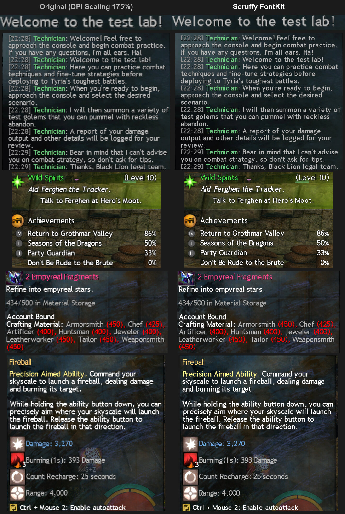

# Scruffy FontKit

[中文说明](README.zh-CN.md)

A [Nexus](https://raidcore.gg/Nexus) addon for Guild Wars 2 that keeps text sharp with DPI Scaling on, or swaps the game font for one you like.

## Features

- **Sharp text with DPI Scaling.** Text is drawn for your screen's scale instead of being stretched, and looks as close to the original font as it can.
- **Your own font.** Pick any font file and the game uses it for its text.
- Builds in the background from the addon's options, and switches without a restart.

## Installation

1. Install [Nexus](https://raidcore.gg/Nexus) and close the game.
2. Download `scruffy-fontkit.dll` from [Releases](https://github.com/diov/scruffy-fontkit/releases/latest) and put it in `<Guild Wars 2>\addons\`.
3. Start the game. Nexus keeps the addon up to date from then on.

## Usage

1. Open the addon's options: Nexus → Addons → Scruffy FontKit.
2. Choose **Game font**, or **My font** and pick a font file (the file decides the weight, such as `-Regular` or `-Bold`). Game font only works with the game's DPI Scaling on and a Windows display scale above 100%; at 100% the options page says so instead of offering a build.
3. Click **Build font pack**. It takes a few minutes and is used as soon as it is built.

Font packs built in the same session stay in a list, so you can switch between them with **Use**. To choose when a new one is used, untick **Use the new font pack as soon as it is built**.

To compare with the original font, click **Show original font**, and **Use font pack again** to switch back.

Build again after changing the Windows display scale, or when the addon asks you to.

## Known issues

- Icons and other UI images stay blurry.
- With your own font, bold and serif text use that same font.
- A few accented letters are one size smaller.
- From a font collection (`.ttc`), only the first font is used.

## Reporting problems

Open an [issue](https://github.com/diov/scruffy-fontkit/issues) with `addons\Nexus\Nexus.log`, and `generate.log` and `font-report.tsv` from `addons\scruffy-fontkit\`.

For stutter, turn on **Debug** in the addon's options. It logs frame times to `Nexus.log` until you turn it off. After it stutters, attach `Nexus.log` before you start the game again, since the game overwrites it.

## Disclaimer

Do not share your font pack, because it contains data from the game files. Use this addon at your own risk; see ArenaNet's [third-party program policy](https://help.guildwars2.com/hc/en-us/articles/360013625034).

[LICENSE](LICENSE) · [Third-party notices](THIRD_PARTY_NOTICES.txt)
