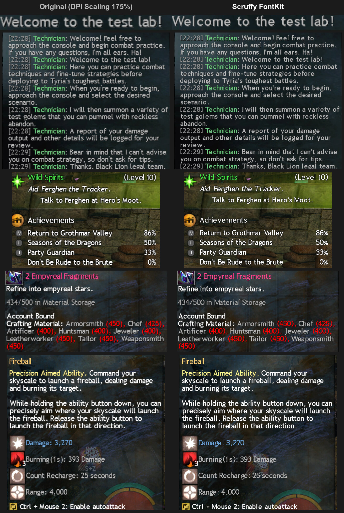

# Scruffy FontKit

[中文说明](README.zh-CN.md)

A [Nexus](https://raidcore.gg/Nexus) addon for Guild Wars 2 that keeps text sharp with DPI Scaling on, or swaps the game font for one you like.

## Installation

1. Install [Nexus](https://raidcore.gg/Nexus) and close the game.
2. Put `scruffy-fontkit.dll` from [Releases](https://github.com/diov/scruffy-fontkit/releases/latest) in `<Guild Wars 2>\addons\`. Nexus keeps it up to date from then on.

## Usage

In Nexus → Addons → Scruffy FontKit:

1. Choose **Game font** for sharp text with DPI Scaling, or **My font** and a font file.
2. Click **Build font pack**. It takes a few minutes and is used without a restart.

Letters keep the original size, and Chinese characters are never smaller than the original. Build again after changing the Windows display scale, or when the addon asks you to.

On the Chinese (CN) client, the options also offer 4 interface sizes; see [the Chinese README](README.zh-CN.md#国服界面大小-4-档).

## Known issues

- Icons and other UI images stay blurry.
- With My font, bold and serif text use that same font.
- From a font collection (`.ttc`), only the first font is used.

## Reporting problems

Open an [issue](https://github.com/diov/scruffy-fontkit/issues) with `addons\Nexus\Nexus.log`, and `generate.log` and `font-report.tsv` from `addons\scruffy-fontkit\`. For stutter, turn on **Debug** in the options first, and attach `Nexus.log` before you start the game again, since the game overwrites it.

## Disclaimer

Do not share your font pack, because it contains data from the game files. Use this addon at your own risk; see ArenaNet's [third-party program policy](https://help.guildwars2.com/hc/en-us/articles/360013625034).

[LICENSE](LICENSE) · [Third-party notices](THIRD_PARTY_NOTICES.txt)
