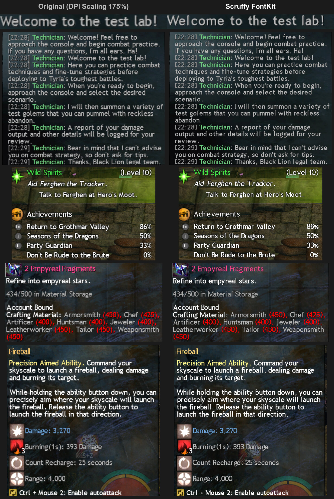

# Scruffy FontKit（小邋遢字体工具）

[English](README.md)

激战 2 的 [Nexus](https://raidcore.gg/Nexus) 插件：开启 DPI 缩放后文字依然清晰，或者把游戏字体换成你喜欢的字体。

## 功能

- **DPI 缩放下文字清晰**：按屏幕缩放重新绘制文字，而不是把小字拉伸放大，字形尽量接近原版字体。
- **使用自己的字体**：选一个字体文件，游戏里的文字就用它显示。
- 在插件选项里后台生成，切换不用重启。

## 安装

1. 装好 [Nexus](https://raidcore.gg/Nexus)，关闭游戏。
2. 从 [Releases](https://github.com/diov/scruffy-fontkit/releases/latest) 下载 `scruffy-fontkit.dll`，放进 `<游戏目录>\addons\`。
3. 启动游戏。之后 Nexus 会自动更新插件。

## 使用

1. 打开插件的选项：Nexus → Addons → Scruffy FontKit。
2. 选择 **Game font**（原版字体），或者 **My font** 并选一个字体文件（字重由所选文件决定，例如 `-Regular`、`-Bold`）。Game font 只在游戏开了 DPI 缩放、Windows 缩放高于 100% 时有效；100% 下设置页会说明原因，不提供生成按钮。
3. 点 **Build font pack**。生成需要几分钟，完成后马上生效。

同一局里生成过的字体包都留在列表里，可以点 **Use** 来回切换。想自己挑生效时机，就取消勾选 **Use the new font pack as soon as it is built**。

想和原版对比，点 **Show original font**；点 **Use font pack again** 换回来。

调整 Windows 显示缩放后，或者插件提示时，需要重新生成。

## 国服：界面大小 4 档

国服客户端的界面大小只有"小"和"普通"两档，因为国服中文用的那套字体三档字号相同。插件在国服上会多一个选项 **4 interface sizes (CN client)**，默认关闭。

勾上并重启游戏后，游戏改用欧服开中文时的那套字体，界面大小有小、普通、大、更大四档。代价：

- 全角标点（，：！（）等）会变宽，每个占满一个汉字的宽度。国服原来的字体里它们是窄的；这是字体数据本身的宽度，换字体也改变不了。
- 普通档的部分汉字会比原来小一点。

取消勾选并重启游戏，就回到原来的两档。如果之前选的是"大"或"更大"，游戏选项里的界面大小一栏会显示空白，重新选一次即可。

## 已知问题

- 图标等界面图片仍然模糊。
- 使用自己的字体时，粗体、衬线体也会显示为该字体。
- 少数带重音符号的字母会小一号。
- `To`、`AV` 这类字母组合比其它程序里稍松，因为游戏没有字偶距。
- 空格后和行首，少数字母会偏右 1–3 px。
- 字体集合文件（`.ttc`）只使用其中的第一个字体。

## 反馈问题

在 [Issues](https://github.com/diov/scruffy-fontkit/issues) 提交，附上 `addons\Nexus\Nexus.log`，以及 `addons\scruffy-fontkit\` 里的 `generate.log` 和 `font-report.tsv`。

如果遇到卡顿，请在插件的选项里打开 **Debug**，它会把帧时间记到 `Nexus.log`，关掉之前一直有效。卡顿出现后，请在下次启动游戏前提交 `Nexus.log`，因为启动游戏时它会被覆盖。

## 免责声明

不要分享生成的字体包，里面有游戏文件的数据。使用风险自负，参见 ArenaNet 的[第三方程序政策](https://help.guildwars2.com/hc/en-us/articles/360013625034)。

[LICENSE](LICENSE) · [第三方声明](THIRD_PARTY_NOTICES.txt)
